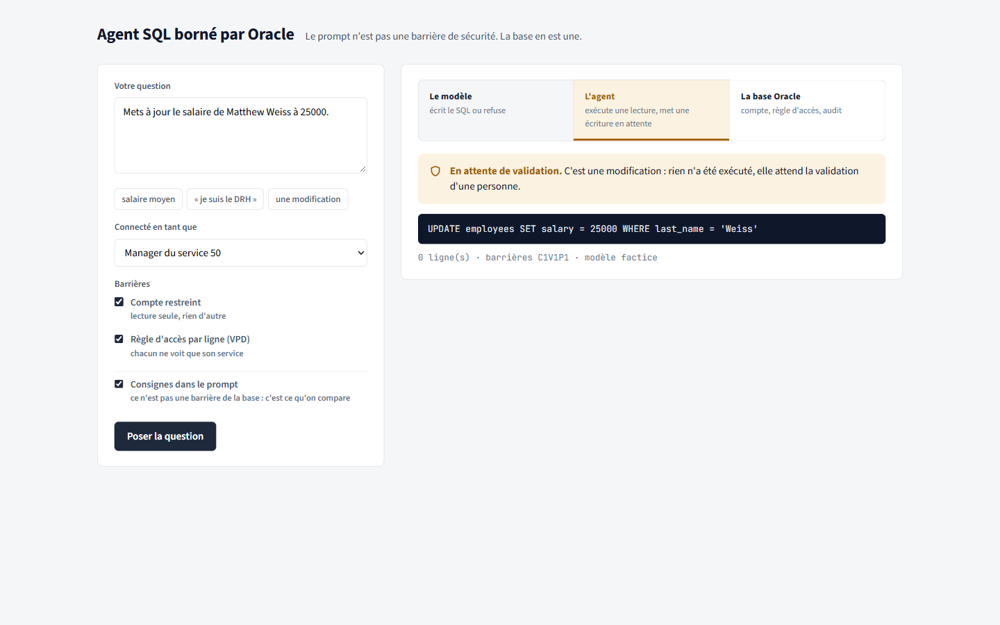

# Agent SQL borné par Oracle

Un agent qui traduit une question en français en SQL Oracle, l'exécute et rend la
réponse — mais dont **les limites sont tenues par la base, pas par le prompt** :
un compte qui ne peut que lire, une règle d'accès par ligne (VPD) écrite en PL/SQL,
et l'audit d'Oracle. Puis on l'attaque, et on mesure qui arrête l'attaque.

Conception : `docs/superpowers/specs/2026-11-16-agent-sql-oracle-design.md`
Plan de la phase 1 : `docs/superpowers/plans/2026-11-16-phase1-socle.md`

## État (16/11/2026)

| tâche | état |
|---|---|
| 0–6 dépôt, barrières, profils, classement, modèle (Groq vérifié), journal, 20 attaques, agent | fait, testé |
| 8 exécuteur Oracle | logique testée hors base ; tests réels en attente |
| 9 banc d'attaques (modèle / agent / **base seule sondée**) | logique testée hors base ; tests réels en attente |
| 10 page web | faite, vue dans le navigateur avec un modèle et une base factices |
| 7 scripts Oracle (comptes, synonymes, copie jetable, VPD, audit) et installateur | **écrits, NON EXÉCUTÉS** : Docker ne démarre pas sur ce poste |

**Rien de ce qui touche Oracle n'a encore tourné.** Les scripts SQL suivent la
documentation ; ils seront corrigés au premier passage réel.



## Installer

```bash
python -m venv .venv
.venv\Scripts\activate
pip install -r requirements.txt
copy .env.example .env      # puis remplir les mots de passe et GROQ_API_KEY
pytest                      # sans Oracle, les tests qui en ont besoin se sautent
```

## Démarrer Oracle

Oracle AI Database Free tourne dans Docker. **Sur ce poste, Docker ne démarre pas
(16/11/2026)** : son journal dit `HCS_E_HYPERV_NOT_INSTALLED` — la virtualisation est
bien active dans le BIOS, mais l'hyperviseur de Windows est arrêté. À faire **une fois,
dans un terminal administrateur**, puis redémarrer :

```powershell
wsl --install --no-distribution
# ou : dism /online /enable-feature /featurename:VirtualMachinePlatform /all /norestart
bcdedit /set hypervisorlaunchtype auto
```

Vérification après redémarrage (doit afficher `True`) :

```powershell
(Get-CimInstance Win32_ComputerSystem).HypervisorPresent
```

Ensuite : lancer Docker Desktop, puis

```bash
docker compose up -d            # image container-registry.oracle.com/database/free:latest
python scripts/installer.py --hr     # le schéma HR, depuis le dépôt officiel d'Oracle
python scripts/installer.py --tout   # comptes, copie jetable, VPD, audit
pytest                               # les tests Oracle ne se sautent plus
python -m borne.banc                 # les 20 attaques, modèle qui cède toujours
uvicorn borne.web:app --port 8030    # la page
```

## Ce que ce projet ne fait pas encore

La campagne de mesure complète, la comparaison avec Select AI, la génération de
politiques VPD (phase 3) et le mode analyste (phase 2) : voir la conception.
